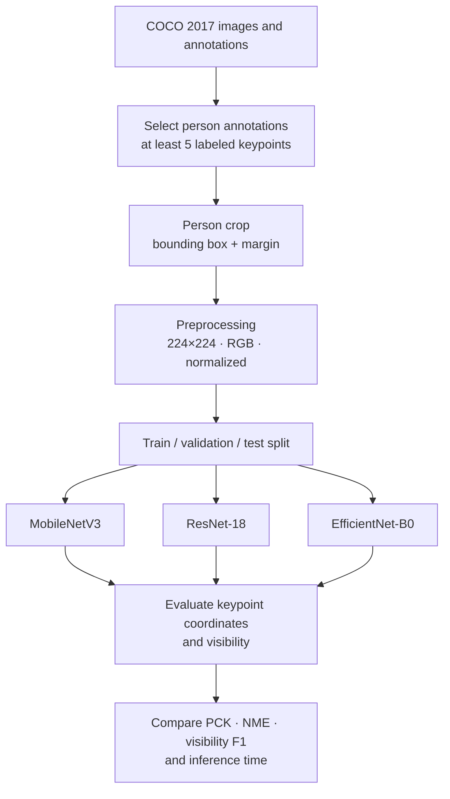

<div align="center">

# 🧍 Human Pose Detection Using Deep Learning

### COCO 2017 Keypoint Estimation · MobileNetV3 vs ResNet-18 vs EfficientNet-B0


</div>

A course project for **Artificial Intelligence and Deep Learning** at **SR University**.  
The project studies 2D human pose estimation by predicting the coordinates and annotation visibility of **17 human body keypoints** from person crops. It compares three CNN backbones—**MobileNetV3, ResNet-18 and EfficientNet-B0**—using a common data preparation and evaluation pipeline.

> **Project scope:** This repository documents the notebook implementation. The reported results are specific to the selected COCO 2017 validation-image subset and the person-crop evaluation setup described below.

---

## 📑 Table of Contents

- [Overview](#-overview)
- [Highlights](#-highlights)
- [Dataset](#-dataset)
- [COCO Keypoint Schema](#-coco-keypoint-schema)
- [Technology Stack](#️-technology-stack)
- [Project Workflow](#-project-workflow)
- [Data Preparation](#-data-preparation)
- [Model Architectures](#-model-architectures)
- [Training Configuration](#-training-configuration)
- [Evaluation Metrics](#-evaluation-metrics)
- [Results](#-results)
- [Key Findings](#-key-findings)
- [Project Structure](#-project-structure)
- [Getting Started](#️-getting-started)
- [Limitations](#️-limitations)
- [Future Scope](#️-future-scope)
- [References](#-references)
- [Author](#-author)

---

## 📖 Overview

Human pose estimation is a computer vision task that identifies important anatomical landmarks in an image. These landmarks—such as the nose, shoulders, elbows, wrists, hips, knees and ankles—can be connected to represent the structure and posture of a person.

This project implements a **2D keypoint regression pipeline**. Given a cropped image of a person, the model predicts normalized x/y coordinates for 17 COCO body keypoints and estimates whether each keypoint is visible. Three CNN architectures are compared to understand the trade-off between localization quality and computational cost.

### 🎯 Problem Statement

| Challenge | Why it matters |
|:---|:---|
| **Joint localization** | The system must estimate accurate positions for body landmarks. |
| **Occlusion** | Some body parts may be hidden or outside the image. |
| **Variation in pose** | People can appear in different orientations, scales and postures. |
| **Architecture choice** | Models can differ in keypoint accuracy, visibility prediction and inference speed. |

### 💡 Proposed Approach

- Use person annotations and keypoint labels from **COCO 2017**.
- Prepare person crops from annotated bounding boxes.
- Resize images to **224 × 224** and normalize them for pretrained CNN backbones.
- Train and compare **MobileNetV3, ResNet-18 and EfficientNet-B0**.
- Predict 17 normalized (x, y) keypoint pairs together with visibility outputs.
- Evaluate localization, visibility classification and inference time.

### 🧭 Objectives and Scope

- Prepare COCO person samples with keypoint annotations.
- Train three CNN backbones under a common training configuration.
- Estimate the locations of 17 human body landmarks.
- Evaluate localization quality using PCK@0.2 and NME.
- Evaluate keypoint visibility with precision, recall and F1-score.
- Compare model inference time.

**In scope:** 2D pose estimation on cropped person images using COCO keypoint annotations.  
**Not claimed by this implementation:** full-scene multi-person detection or a production real-time tracking application.

### ⚡ At a Glance

| | |
|:---|:---|
| **Task** | 2D human pose estimation / keypoint regression |
| **Dataset source** | COCO 2017 keypoint annotations |
| **Keypoints** | 17 body landmarks |
| **Input resolution** | 224 × 224 RGB |
| **Models** | MobileNetV3 · ResNet-18 · EfficientNet-B0 |
| **Framework** | PyTorch 2.14.1+cu130 / Torchvision 0.29.1+cu130 (reported runtime) |
| **GPU** | NVIDIA Tesla T4 (14.56 GB reported) |
| **Optimizer** | AdamW |
| **Batch size** | 32 |
| **Learning rate** | 0.0001 |
| **Maximum epochs** | 20 per model |
| **Random seed** | 42 |

### 🏁 Results Snapshot

| Metric | MobileNetV3 | ResNet-18 | EfficientNet-B0 |
|:---|---:|---:|---:|
| PCK@0.2 ↑ | 0.8064 | **0.8598** | 0.8532 |
| NME ↓ | 0.1291 | **0.1184** | 0.1198 |
| Visibility F1 ↑ | 0.8546 | **0.8727** | 0.8676 |
| Inference time (ms) ↓ | 2.8381 | **1.9158** | 2.2905 |

**Best overall in the notebook's reported comparison: ResNet-18.** It achieved the highest PCK@0.2 and visibility F1, the lowest NME, and the shortest measured inference time.

---

## ✨ Highlights

- 🧍 **17 COCO body keypoints** represented as normalized 2D coordinates.
- 🖼️ **224 × 224 RGB** person-crop input pipeline.
- 🧠 **3 CNN backbones** compared: MobileNetV3, ResNet-18 and EfficientNet-B0.
- 🎯 **Localization evaluation** using PCK@0.2 and NME.
- 👁️ **Visibility evaluation** using precision, recall and F1-score.
- ⚡ **Inference-time comparison** across the three models.
- ♻️ Fixed random seed and a common training configuration for comparison.

---

## 🗂️ Dataset

The project uses **COCO 2017** person annotations and keypoint labels. The notebook loads the `val2017` image/annotation source and selects a subset of image IDs for this experiment. The final split is defined in a later cell and overrides the earlier 200 / 50 / 50 configuration values.

### Dataset Setup Reported in the Notebook

| Property | Details |
|:---|:---|
| Dataset | COCO 2017 |
| Image annotation source | `instances_val2017` and person keypoint annotations |
| Person category | `category_id = 1` |
| Keypoints | 17 per person |
| Minimum annotation filter | At least 5 labeled keypoints |
| Selected image IDs | 700 |
| Crop input size | 224 × 224 |

The notebook's initial selection defines a smaller sample, then later replaces it with a **500 / 100 / 100 image-ID split** for train, validation and test. After expanding selected images into qualifying person annotations, the reported sample counts are:

| Split | Person samples |
|:---|---:|
| Training | 1,313 |
| Validation | 248 |
| Testing | 265 |
| **Total** | **1,826** |

> These counts refer to the selected notebook subset and the person annotations that pass its filtering. They are not the full COCO 2017 dataset counts.

### Person Crop Preparation

1. Read the person bounding box from the COCO annotation.
2. Expand the box by a margin of approximately 10%.
3. Crop the person region from the original image.
4. Resize the crop to 224 × 224 pixels.
5. Transform keypoint coordinates to the crop coordinate system and normalize them to the [0, 1] range.

---

## 🦴 COCO Keypoint Schema

The COCO person format contains **17 keypoints** in a fixed order.

| Index | Keypoint |
|:-:|:---|
| 1 | Nose |
| 2 | Left eye |
| 3 | Right eye |
| 4 | Left ear |
| 5 | Right ear |
| 6 | Left shoulder |
| 7 | Right shoulder |
| 8 | Left elbow |
| 9 | Right elbow |
| 10 | Left wrist |
| 11 | Right wrist |
| 12 | Left hip |
| 13 | Right hip |
| 14 | Left knee |
| 15 | Right knee |
| 16 | Left ankle |
| 17 | Right ankle |

Each annotated keypoint is represented by **(x, y, v)**:
- `x`: horizontal image coordinate.
- `y`: vertical image coordinate.
- `v`: COCO visibility annotation.
- The model uses normalized coordinates and a visibility target for training/evaluation.

---

## 🛠️ Technology Stack

| Category | Technology |
|:---|:---|
| Programming language | Python |
| Deep learning framework | PyTorch |
| Model library | Torchvision |
| Dataset / annotations | COCO 2017 |
| Data processing | NumPy, Python imaging utilities |
| Evaluation | Notebook metric implementations |
| Platform | Google Colab |
| Hardware | Colab GPU (notebook environment) |
| Optimizer | AdamW |

---

## 🔄 Project Workflow



### Model Output

The prediction head represents two related tasks:

- **Keypoint coordinate regression:** predicts x/y locations for 17 body landmarks.
- **Visibility prediction:** estimates whether each keypoint is visible.

The coordinate output therefore contains 34 values (17 × 2), alongside visibility predictions for the 17 landmarks.

---

## 🧪 Data Preparation

| Step | Applied operation | Purpose |
|:---|:---|:---|
| Annotation filtering | Person annotations with at least 5 labeled keypoints | Remove very sparse labels |
| Bounding-box crop | Crop person region with 10% margin | Focus on the subject |
| Resize | 224 × 224 | Standardize model input |
| Color format | RGB | Three-channel input |
| Tensor conversion | Convert image to tensor | Feed into PyTorch |
| Normalization | ImageNet mean and standard deviation | Match pretrained backbone input convention |
| Coordinate transform | Convert keypoint locations to crop-relative normalized coordinates | Standardize regression targets |
| Visibility target | Derive visibility supervision from COCO annotations | Train visibility prediction |

---

## 🧠 Model Architectures

The notebook compares three convolutional neural network backbones. Their role is to extract image features that are used by the pose-estimation prediction head.

| Feature | MobileNetV3 | ResNet-18 | EfficientNet-B0 |
|:---|:---|:---|:---|
| Main design | Lightweight mobile CNN | Residual connections | Compound scaling and MBConv |
| Main purpose | Efficient feature extraction | Strong residual baseline | Parameter-efficient feature extraction |
| Project role | Lightweight comparison | Residual model comparison | Efficient architecture comparison |

### MobileNetV3

MobileNetV3 is designed for computational efficiency. Its lightweight building blocks make it useful when model size and inference cost are important considerations.

### ResNet-18

ResNet-18 uses residual/skip connections. These connections allow a block to learn a residual mapping while preserving an identity path for information and gradients.

### EfficientNet-B0

EfficientNet-B0 uses mobile inverted bottleneck blocks and a compound-scaling design. It aims to balance network depth, width and input resolution.

---

## ⚙️ Training Configuration

The notebook uses the following reported training settings. The initial configuration cell sets `EPOCHS = 5`, but a later cell resets it to `20` before the training loop; the recorded run therefore trains each model for 20 epochs.

| Parameter | Value |
|:---|:---|
| Input size | 224 × 224 |
| Batch size | 32 |
| Maximum epochs | 20 (the later training cell overrides an earlier value of 5) |
| Optimizer | AdamW |
| Learning rate | 0.0001 |
| Weight decay | 0.0001 |
| Data loader workers | 2 |
| Random seed | 42 |
| Models | MobileNetV3, ResNet-18, EfficientNet-B0 |

---

## 📏 Evaluation Metrics

| Metric | Meaning | Better |
|:---|:---|:---:|
| **PCK@0.2** | Percentage of visible keypoints predicted within the normalized distance threshold | ↑ |
| **NME** | Normalized mean error between predicted and ground-truth keypoint locations | ↓ |
| **Visibility Precision** | Fraction of predicted-visible keypoints that are actually visible | ↑ |
| **Visibility Recall** | Fraction of visible ground-truth keypoints correctly identified | ↑ |
| **Visibility F1** | Harmonic mean of visibility precision and recall | ↑ |
| **Inference time** | Average time to produce a prediction for an image | ↓ |

---

## 📊 Results

The following values are the results reported by the project notebook.

### Test-Set Model Comparison

| Metric | MobileNetV3 | ResNet-18 | EfficientNet-B0 |
|:---|---:|---:|---:|
| PCK@0.2 ↑ | 0.8064 | **0.8598** | 0.8532 |
| NME ↓ | 0.1291 | **0.1184** | 0.1198 |
| Visibility Precision ↑ | 0.8493 | 0.8599 | **0.8633** |
| Visibility Recall ↑ | 0.8601 | **0.8858** | 0.8719 |
| Visibility F1 ↑ | 0.8546 | **0.8727** | 0.8676 |
| Inference time (ms) ↓ | 2.8381 | **1.9158** | 2.2905 |

### Training Time Reported by the Notebook

| Model | Training time |
|:---|---:|
| MobileNetV3 | 3.39 minutes |
| ResNet-18 | 3.49 minutes |
| EfficientNet-B0 | 3.69 minutes |

These are single-run timings from the reported Colab Tesla T4 session.

### 🏆 Best Overall Model: ResNet-18

| Metric | Result |
|:---|---:|
| PCK@0.2 | **0.8598** |
| NME | **0.1184** |
| Visibility Precision | 0.8599 |
| Visibility Recall | **0.8858** |
| Visibility F1 | **0.8727** |
| Inference time | **1.9158 ms** |

ResNet-18 achieved the strongest overall result across the notebook's localization metrics, visibility F1 and measured inference time. EfficientNet-B0 obtained the highest visibility precision (0.8633).

### Key Findings

- **ResNet-18** achieved the highest PCK@0.2 (0.8598), indicating the strongest keypoint localization under the notebook's PCK threshold.
- **ResNet-18** achieved the lowest NME (0.1184), indicating the lowest normalized localization error.
- **ResNet-18** achieved the highest visibility recall (0.8858) and visibility F1 (0.8727).
- **EfficientNet-B0** recorded the highest visibility precision (0.8633).
- **ResNet-18** had the shortest reported inference time (1.9158 ms per image) in this experiment.

> Timing values depend on the runtime environment and measurement procedure. They should not be interpreted as guaranteed deployment latency.

---

## 📁 Project Structure

The GitHub repository was empty when inspected, so the following is a suggested structure for organizing the notebook and project artifacts. Adjust the paths to match the files you upload.

```text
AI-DL-PROJECT/
│
├── notebooks/
│   └── Human_pose_detectionAI_DL.ipynb
│
├── outputs/
│   ├── figures/
│   ├── checkpoints/
│   └── results/
│
├── reports/
│   └── Human_Pose_Detection_Report.pdf
│
├── README.md
└── requirements.txt
```

---

## ⚙️ Getting Started

### Prerequisites

- Python 3.10 or later (recommended)
- Jupyter Notebook or Google Colab
- PyTorch and Torchvision
- COCO 2017 images and annotation files
- GPU recommended for model training

### 1. Clone the Repository

```bash
git clone https://github.com/fasi9618/AI-DL-PROJECT.git
cd AI-DL-PROJECT
```

### 2. Install Dependencies

Install the packages used by the notebook environment. A baseline environment is:

```bash
pip install torch torchvision numpy pandas matplotlib pillow pycocotools
```

> Check the notebook's import and installation cells for the exact dependency versions used in your run.

### 3. Open the Notebook

**Option A: Google Colab**

1. Open Google Colab.
2. Upload `notebooks/Human_pose_detectionAI_DL.ipynb`.
3. Select a GPU runtime when available.
4. Make sure the COCO images and annotation files are available at the paths expected by the notebook.
5. Run the notebook cells in order.

**Option B: Local Jupyter**

```bash
pip install jupyter
jupyter notebook
```

Open the notebook and execute the cells in order after configuring the dataset paths.

---

## ⚠️ Limitations

- The experiment uses a selected subset of COCO 2017 validation images rather than the complete COCO dataset. The image IDs are partitioned into 500 / 100 / 100 groups, then expanded to 1,313 / 248 / 265 person instances.
- The pipeline uses ground-truth person annotations and bounding boxes to create person crops. It does not itself demonstrate end-to-end person detection in an uncropped scene.
- Results depend on the selected subset, filtering conditions, preprocessing and evaluation implementation. The notebook applies tensor conversion and ImageNet normalization but does not define a separate training-only augmentation pipeline.
- A single reported run does not establish statistical significance between the architectures. The models are trained for 20 epochs without early stopping, and the saved weights are the weights after the final epoch.
- Occlusion, truncation and difficult poses can make keypoint localization challenging.
- Inference timing depends on hardware, batch size and the measurement method. The notebook times the forward pass with CUDA synchronization and reports milliseconds per person crop.
- This is an educational project, not a validated medical, safety or surveillance system.

---

## 🗺️ Future Scope

- Train and evaluate with a larger portion of COCO and additional pose datasets.
- Add a person detector to support full-scene, multi-person pose estimation.
- Build a webcam demonstration for live pose visualization.
- Investigate data augmentation and improved handling of occluded keypoints.
- Compare additional pose-estimation architectures and heatmap-based approaches.
- Add downstream applications such as exercise repetition counting and activity recognition.
- Evaluate on multiple random seeds and report confidence intervals.

---

## 📚 References

1. T.-Y. Lin et al., “Microsoft COCO: Common Objects in Context,” *European Conference on Computer Vision (ECCV)*, 2014.
2. G. Papandreou et al., “Towards Accurate Multi-person Pose Estimation in the Wild,” *CVPR*, 2017.
3. K. He et al., “Deep Residual Learning for Image Recognition,” *CVPR*, 2016.
4. A. Howard et al., “Searching for MobileNetV3,” *ICCV*, 2019.
5. M. Tan and Q. V. Le, “EfficientNet: Rethinking Model Scaling for Convolutional Neural Networks,” *ICML*, 2019.
6. A. Paszke et al., “PyTorch: An Imperative Style, High-Performance Deep Learning Library,” *NeurIPS*, 2019.

---

## 👨‍💻 Author

**Fasi Mohd**  
B.Tech, Computer Science and Engineering  
SR University, Warangal, Telangana, India

---

<div align="center">

### 🧍 Human Pose Detection Using Deep Learning

**2D keypoint estimation with CNN architectures**

Made for learning · Educational use only

</div>
